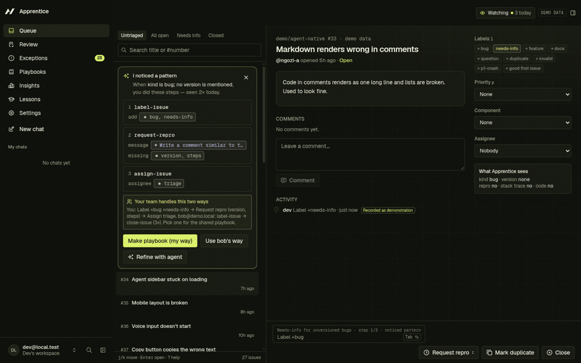
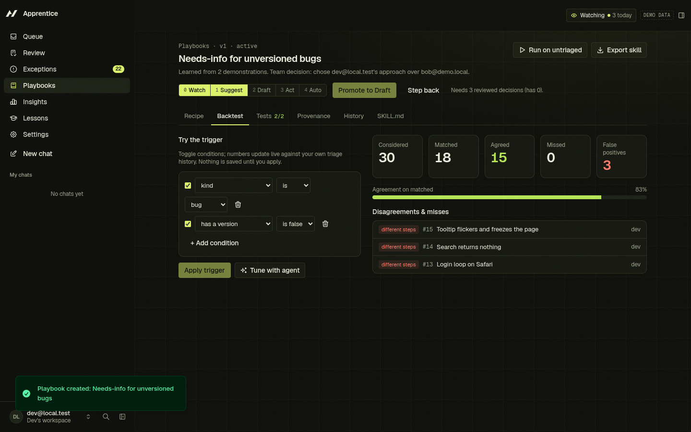
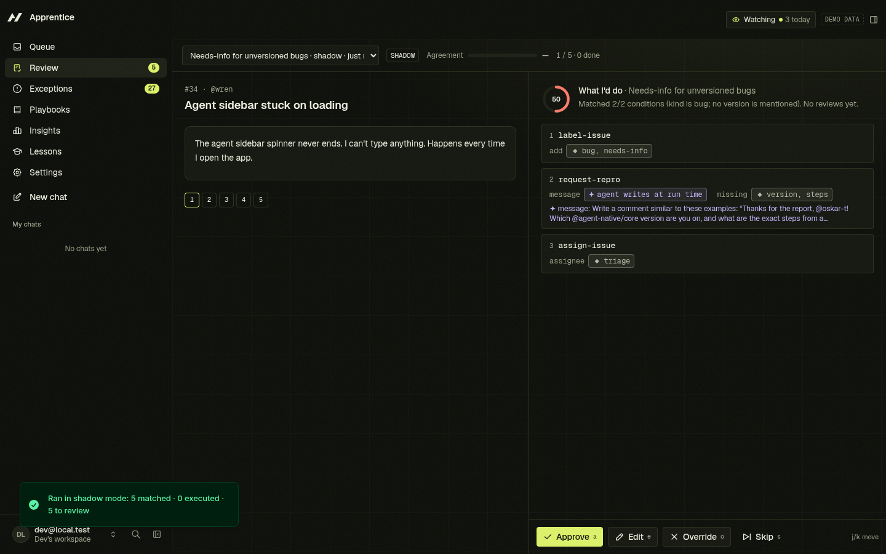
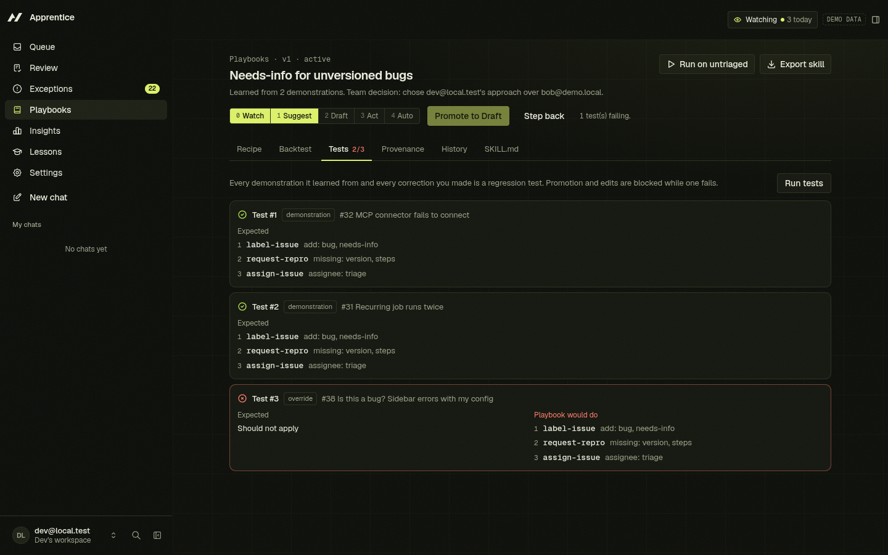
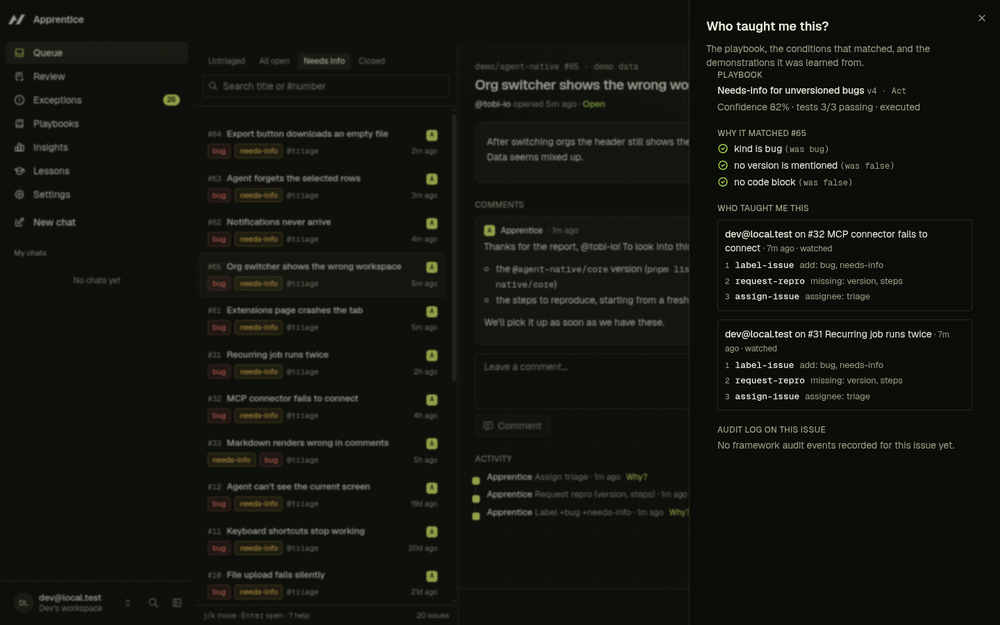

# Apprentice

**Show it once, delegate forever.** Apprentice is an [Agent-Native](https://www.agent-native.com) app where the agent learns your job by watching you do it. It proves what it learned, then earns autonomy one step at a time.

Built for the [Builder.io Agent-Native Hackathon](https://www.builder.io/hackathon). **Website: [apprentice-agent.pages.dev](https://apprentice-agent.pages.dev)**



## The problem

Every team has queue work: issue triage, support tickets, inbound requests. It is repetitive, but it carries judgment, like "no version number, so ask for one" or "crash with a stack trace, so P1 and core". Today's agents make you *describe* that judgment in a prompt and then hope. Nobody trusts the result, so the work stays manual.

## The insight

In Agent-Native, the UI and the agent call **the same typed actions**. Every click a human makes is already a structured, validated operation, and the framework's audit log records who made it. **Your normal work is already a machine-readable demonstration.** Apprentice turns demonstrations into skills: no screen scraping and no prompt writing.

## The loop

| | What happens | Where |
|---|---|---|
| **Watch** | You triage issues by hand. Each typed action is recorded as a step in a demonstration, together with the issue's features and the screen state. | Queue · "Watching ● N today" |
| **Notice** | After two similar demonstrations, Apprentice proposes a playbook. It infers a discriminative trigger from your history, and decides for each parameter whether it is *fixed*, *from the issue* or *agent decides*. | Pattern card |
| **Assist** | Before the playbook even exists, a ghost chip predicts your next step. Press `Tab` to run it through the same action. | Issue action bar |
| **Edit** | A visual recipe: trigger → steps → checkpoints, with color-coded parameter owners. Every save is a new version, and the recipe is regenerated as a `SKILL.md`. | Playbook editor |
| **Prove** | It backtests against your own history ("matched 18, agreed 15") and updates live as you toggle conditions. **Every correction you make becomes a regression test**, and promotions or edits that break a test are blocked. | Backtest · Tests |
| **Trust** | 0 Watch · 1 Suggest (shadow mode) · 2 Draft (asks first) · 3 Act (with undo) · 4 Auto. Promotion needs evidence and a human click. An override at Act demotes it automatically. | Trust ladder · Review |
| **Scale** | A scheduled autopilot runs your playbooks and posts a digest. You can review a batch from Claude or ChatGPT through MCP Apps, and export each skill for any agent. | Insights · Settings |

| Backtest with live tuning | Shadow review |
|---|---|
|  |  |
| **Your override became a failing test** | **"Who taught you this?"** |
|  |  |

## How it uses Agent-Native

| Apprentice feature | Framework mechanism |
|---|---|
| Demonstrations | Domain `defineAction`s are the only write path. Human calls (`caller: "frontend"`) are recorded as steps. The audit log (`audit.target` = issue) backs provenance. |
| Context capture | `readAppState("navigation" / "selection")` is snapshotted with every step. Lessons merge the framework **Recorder** report. |
| Agent awareness | `view-screen` hydrates the open issue, ghost suggestion, playbook, focused decision and pattern candidates. Navigation state covers every route. |
| Agent moves the UI | `focus-issue` writes the one-shot `navigate` command (issue, playbook tab, review run, side-by-side compare). |
| **Trust ladder** | A **`needsApproval` predicate** on every domain action: calls that carry `playbookContext` are gated by the playbook's level and checkpoint/destructive flags. At Draft the agent's call pauses with Approve/Deny in chat. Ad-hoc calls are never gated. |
| Live tuning | The Backtest tab calls `backtest-playbook` with a trigger override. The `apprentice-teacher` skill tells the agent to render the same tuner as generative UI (`render-inline-extension` + `appAction`). |
| Tests | Playbook regression tests are stored in Postgres. The agent-behavior gate is `evals/apprentice.eval.ts` (`defineEval`, `usesTool`, `llmJudge`, a custom scorer). |
| Autopilot | `install-autopilot` writes `jobs/apprentice-autopilot.md` into Agent Resources (`resourcePut`). Run it from Settings › Automations. |
| Digest | `build-digest` stores the digest in-app, and the automation's reply goes to Slack when Messaging is connected. |
| External agents | `mcpTool: true` on `list-playbooks`, `run-playbook`, `review-batch`, `get-insights` and `export-skill`. `review-batch` uses **`embedRoute`**, so the real `/review` route renders inline in MCP App hosts. |
| Live sync | Mutations invalidate action queries. `useDbSync({ realtime })` is used only on Queue and Review, where the agent or autopilot changes data while you watch. |
| Agent instructions | `AGENTS.md` plus four skills (`triage-domain`, `apprentice-teacher`, `playbook-runner`, `shadow-reviewer`), with voice intents for realtime speech mode. |

Architecture, framework rules and doctor checks are covered in [PROGRESS.md](PROGRESS.md).

## Run it locally

Requires Node 22.22+ and pnpm.

```bash
git clone https://github.com/LSUDOKO/Apprentice.git
cd Apprentice
corepack enable && pnpm install
pnpm dev                     # opens http://localhost:8080
```

> If your shell sets `NODE_OPTIONS=--no-experimental-strip-types`, run `env -u NODE_OPTIONS pnpm dev`. The framework loads `agent-native.config.ts` with Node's built-in TypeScript support.

1. Choose **Load demo data**: 60 invented issues plus past demonstrations, including a second teacher for Team mode.
2. Triage **#31** and **#32** by hand: label `bug` and `needs-info`, *Request repro* (`r`), assign `triage`. The pattern card appears.
3. Open **#33** and add `needs-info`. The ghost chip offers the rest; press `Tab`.
4. **Make playbook** → Backtest → **Run on untriaged** → review with `a` / `o`. Override #38 with "shouldn't apply" and it becomes test #3.
5. Fix the trigger (add *has a code block = false*) → **Promote to Draft** → Settings › **Simulate 4 new issues** → run → *Approve & apply* → **Promote to Act** → run again, and it acts on its own. Then **Undo run**.

For the agent (chat, voice, Draft-level approvals, the generative-UI tuner, evals), add an LLM key to `.env` (`ANTHROPIC_API_KEY=…`, `OPENAI_API_KEY=…` or `GROQ_API_KEY=…`) or connect Builder.io from the app.

```bash
pnpm typecheck               # TypeScript strict
pnpm test                    # 55 engine + integration tests (in-memory PGlite)
pnpm agent-native:doctor     # framework guards
pnpm eval                    # agent behavior gate (needs an LLM key)
pnpm seed:generate           # regenerate the deterministic demo dataset
```

## Project layout

```
actions/                       one defineAction per operation (UI, agent, MCP and CLI all call these)
server/apprentice/engine/      pure TypeScript: features, signatures, trigger inference, bindings,
                               backtest, tests, trust ladder, drift, ghost prediction, SKILL.md
server/apprentice/services/    DB-backed services: issue mutation path, step recording, patterns,
                               playbooks, executor + undo, provenance, insights, seed
server/db/                     Drizzle schema + additive migrations (Postgres / PGlite)
app/routes/                    issues, playbooks, review, exceptions, insights, lessons, compare, preferences
app/components/apprentice/     trust ladder, param chips, recipe editor, ghost chip, provenance drawer
.agents/skills/                agent skills;  AGENTS.md  agent instructions
evals/                         agent-behavior eval gate
apprentice-build-kit/          the original spec this was built from
landing/                       marketing site (Vite + React + Framer Motion), deployed to Cloudflare Pages
```

## Built during the hackathon

See [BUILT-DURING-HACKATHON.md](BUILT-DURING-HACKATHON.md). The Agent-Native `chat` template is the starting point. Everything under `actions/`, `server/apprentice`, `server/db`, the Apprentice routes and components, the seed data and the tests are new.

## Limitations and next steps

- Learning is per user. Team mode compares teachers inside one workspace's history, but playbooks are not shared through org-level sharing yet.
- Steps that commute (label vs. assign order) are treated as different signatures.
- Agent-decides parameters are not scored in backtests. Judgment backtests through sub-agents (Agent Teams) are not built; judgments are resolved sequentially by the agent.
- GitHub import is read-only and unauthenticated (60 requests/hour). Apprentice never writes to GitHub.
- The exported `SKILL.md` uses the standard skill format; compatibility with other skill runtimes has not been tested.

## License

MIT
