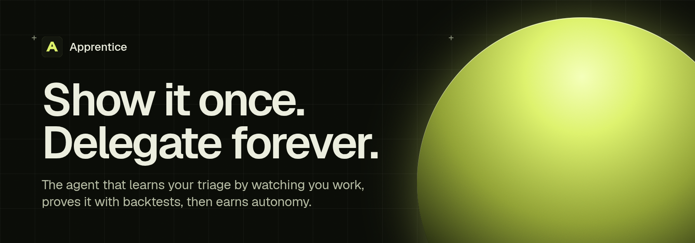
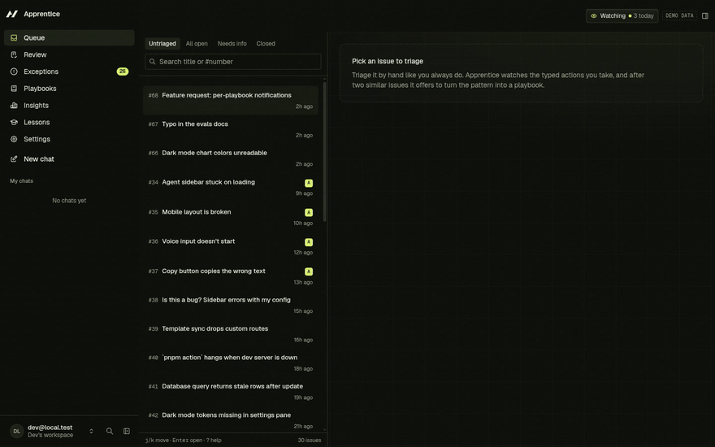
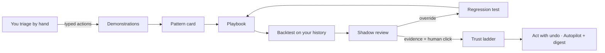
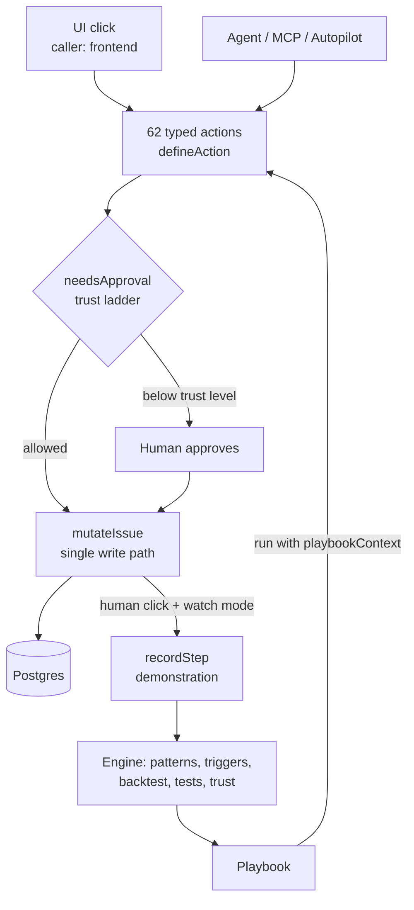
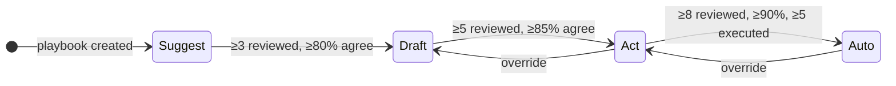
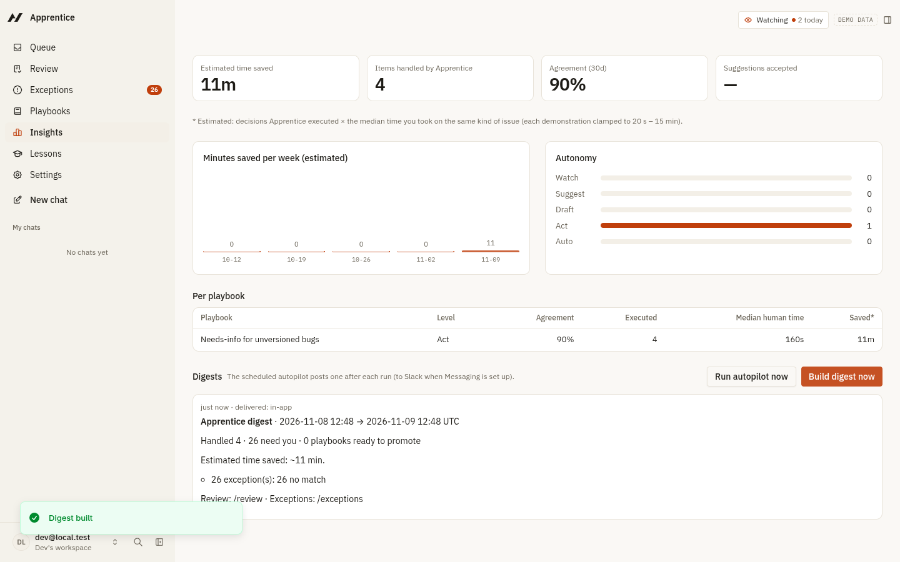

<p align="center">
  
</p>

<p align="center">
  <a href="https://apprentice-agent.onrender.com"></a>
  <a href="https://apprentice-agent.pages.dev"></a>
  <a href="docs/deck/Apprentice-deck.pdf"></a>
</p>
<p align="center">
  
  
  
  
  
  
</p>

**Apprentice** is an [Agent-Native](https://www.agent-native.com) app for issue triage that learns your job by watching you do it. You triage as usual. It records your clicks as typed demonstrations, turns a repeated pattern into an editable **playbook**, **backtests** it on your own history, turns every correction into a **regression test**, and earns autonomy one rung at a time on a **trust ladder**. You never write a prompt.

Built for the [Builder.io Agent-Native Hackathon](https://www.builder.io/hackathon) (November 2026) by Arpit Singh.

<p align="center">
  
  <br /><sub>Real recording of the running app. Full quality: <a href="docs/demo.mp4">docs/demo.mp4</a>. The 3-minute narrated film is built from <a href="video/">video/</a> (script: <a href="docs/video/VIDEO-SCRIPT.md">docs/video/VIDEO-SCRIPT.md</a>).</sub>
</p>

## At a glance

| Claim | Proof |
|---|---|
| A click and an agent call are the same typed action, so every click is a demonstration | [`services/issues.ts#L204`](server/apprentice/services/issues.ts#L204): a call is a demonstration when `ctx.caller === "frontend"` |
| The trust ladder is the framework's `needsApproval` hook | [`action-helpers.ts#L43`](server/apprentice/action-helpers.ts#L43) → [`services/approval.ts#L14`](server/apprentice/services/approval.ts#L14) |
| Playbooks are backtested on your history before they act | [`engine/backtest.ts`](server/apprentice/engine/backtest.ts) · Backtest tab |
| Every correction becomes a regression test; an override at Act steps the playbook back | [`engine/tests.ts`](server/apprentice/engine/tests.ts) · [`engine/trust.ts#L86`](server/apprentice/engine/trust.ts#L86) |
| It works on real GitHub issues, read-only | Settings → Import · [`services/ops.ts`](server/apprentice/services/ops.ts) (`importGithubIssues`) |
| The whole loop is tested end to end | [`server/apprentice/__tests__/flow.test.ts`](server/apprentice/__tests__/flow.test.ts) · `pnpm test` → 55 passing |

Full list with line numbers: **[docs/AGENT-NATIVE-EVIDENCE.md](docs/AGENT-NATIVE-EVIDENCE.md)**. Architecture and diagrams: **[docs/ARCHITECTURE.md](docs/ARCHITECTURE.md)**. Machine-readable index for coding agents: **[llms.txt](llms.txt)**.

## Try it in 60 seconds

| | |
|---|---|
| **Live app** | https://apprentice-agent.onrender.com (Render free tier: the first visit can take about a minute to wake up) |
| **Demo account** | `judge@apprentice-demo.dev` / `apprentice-demo-2026` (demo data and 30 real agent-native issues already loaded). Or create your own account and press **Load demo data**. |
| **Website** | https://apprentice-agent.pages.dev |
| **Pitch deck** | [docs/deck/Apprentice-deck.pdf](docs/deck/Apprentice-deck.pdf) |

Then:
1. Open **#31**, click `+ needs-info`, `+ bug`, **Request repro**, assign `triage`. Do the same on **#32**.
2. The **pattern card** appears. On **#33**, add `needs-info` and press `Tab` to accept each predicted step.
3. **Make playbook** → **Backtest**: untick a condition and watch matched, agreed and false positives change.
4. **Run on untriaged** → **Review**: approve with `a`, override with `o` (your override becomes a test).
5. Promote to **Draft**, then **Act**, run again, open **Why?** on a handled issue, and **Undo run**.
6. Settings → Data → import `BuilderIO/agent-native` to try it on real issues.

## The problem

Queue work (issue triage, support tickets, inbound requests) is repetitive but full of judgment: "no version, so ask for one", "a crash with a stack trace, so P1". Today's agents make you write that judgment as a prompt and then hope. Nobody trusts the result, so the work stays manual.

## The insight

In Agent-Native, the UI and the agent call **the same typed actions** (`defineAction`). A click is already a structured, validated operation, so **your normal work is already a machine-readable demonstration**. Apprentice learns from it, then has to prove what it learned before it may act.



## How it works

Every caller (UI, agent, MCP client, scheduler) goes through the same actions and the same approval gate, and every issue write goes through one function.



The trust ladder (demo-mode thresholds; every promotion also needs all regression tests passing and a human click):



| Level | What a playbook may do |
|---|---|
| 0 Watch | Nothing; it only records |
| 1 Suggest | Shadow mode: proposes decisions, changes nothing until you approve |
| 2 Draft | Asks before every step |
| 3 Act | Runs on its own, asks only at checkpoints or destructive steps; one-click undo |
| 4 Auto | Runs on its own |

## Features

| | What happens | Where |
|---|---|---|
| **Watch** | Each action you take in the UI is recorded with the issue's features and the screen state. | Header: "Watching ● N today" |
| **Notice** | After two similar demonstrations, a pattern card proposes a playbook with an inferred trigger and, per parameter, *fixed* / *from the issue* / *agent decides*. If a teammate does it differently, both approaches are shown and the team picks one. | Pattern card |
| **Assist** | A ghost chip predicts your next step. `Tab` runs it through the same action. | Issue action bar |
| **Edit** | Visual recipe: trigger, steps, checkpoints. Every save is a version and regenerates a portable `SKILL.md`. | Playbook editor |
| **Prove** | Backtest against your history with live toggles. Every correction becomes a regression test; promotions and edits that break a test are blocked. | Backtest · Tests |
| **Trust** | Watch → Suggest → Draft → Act → Auto. Promotion needs evidence and a human click; an override at Act or Auto steps back automatically. | Trust ladder · Review |
| **Explain** | "Who taught you this?" names the exact demonstrations, matched conditions and framework audit events behind every automated change. | **Why?** on any activity |
| **Undo** | One click reverts a whole run; later conflicting edits are protected. | Review |
| **Real data** | Import open issues from any public GitHub repo (read-only, never writes back). | Settings → Data |
| **Scale** | Scheduled autopilot, digest, MCP tools so Claude, ChatGPT or Cursor can review a batch inline, skill export. | Insights · Settings |

| Live backtest | Your override became a failing test |
|---|---|
|  |  |
| **"Who taught you this?"** | **Insights dashboard** |
|  |  |

## Real data: BuilderIO/agent-native

The demo history is invented (and labelled "demo data") because backtests and the team-conflict feature need past decisions. On top of it, Apprentice imports real open issues from [github.com/BuilderIO/agent-native](https://github.com/BuilderIO/agent-native). In the recorded demo:

- Real issues **#8301** and **#8141** ("Error screen: Something went wrong", no version, no steps) are handled by the learned needs-info playbook.
- Real issue **#8918** is a feature request that the rule matched by mistake. Overriding it saved **regression test #3** and stepped the playbook back from Act to Draft ("override at autonomy").

## For reviewers: rubric → evidence

| Criterion | What to look at | Evidence |
|---|---|---|
| **Usefulness & execution** (40%) | A complete working loop that removes manual triage: watch → pattern → playbook → backtest → review → test → promote → act → explain → undo, on real issues. | Live app · [`flow.test.ts`](server/apprentice/__tests__/flow.test.ts) · 55 tests · [PROGRESS.md](PROGRESS.md) (browser click-through log) |
| **Creativity & design** (20%) | Trust ladder, ghost chip, parameter-owner chips, provenance drawer, live backtest toggles, dashboard with promotion-gate lines, keyboard-first review, dark brand theme. | [`app/components/apprentice/`](app/components/apprentice/) · [`app/routes/insights.tsx`](app/routes/insights.tsx) · [`app/global.css`](app/global.css) |
| **Innovation** (20%) | Learns from what you do instead of what you write; corrections become tests; autonomy is earned with evidence, not granted. | [`engine/patterns.ts`](server/apprentice/engine/patterns.ts), [`backtest.ts`](server/apprentice/engine/backtest.ts), [`tests.ts`](server/apprentice/engine/tests.ts), [`trust.ts`](server/apprentice/engine/trust.ts) |
| **Use of Agent-Native** (20%) | One set of actions for UI, agent and MCP; human calls become demonstrations; the trust ladder is `needsApproval`; `view-screen`, `embedRoute`, `resourcePut`, audit log, skills, evals. | [docs/AGENT-NATIVE-EVIDENCE.md](docs/AGENT-NATIVE-EVIDENCE.md) |

## How it uses Agent-Native

| Apprentice feature | Framework mechanism | Code |
|---|---|---|
| Demonstrations | Domain `defineAction`s are the only write path; calls with `caller: "frontend"` are recorded as steps | [`issues.ts#L204`](server/apprentice/services/issues.ts#L204) |
| Context capture | `readAppState("navigation" / "selection")` snapshotted with every step; Lessons merge the framework **Recorder** report | [`record-step.ts#L18`](server/apprentice/services/record-step.ts#L18) |
| Agent awareness | `view-screen` hydrates the open issue, ghost suggestion, playbook, focused decision and pattern candidates | [`view-screen.ts`](actions/view-screen.ts) |
| Agent moves the UI | `focus-issue` writes the one-shot `navigate` command | [`focus-issue.ts#L28`](actions/focus-issue.ts#L28) |
| **Trust ladder** | `needsApproval` on every domain action, decided by the playbook's level and checkpoint flags; ad-hoc calls never gated; errors fail closed | [`approval.ts`](server/apprentice/services/approval.ts) |
| Provenance | `audit.target` = issue on every domain action; "Why?" reads the framework audit log | [`executor.ts#L530`](server/apprentice/services/executor.ts#L530) |
| Autopilot | `install-autopilot` writes a scheduled job with `resourcePut` | [`install-autopilot.ts#L37`](actions/install-autopilot.ts#L37) |
| External agents | `mcpTool: true` on five actions; `review-batch` uses `embedRoute` so `/review` renders inline in MCP App hosts | [`review-batch.ts#L16`](actions/review-batch.ts#L16) |
| Live sync | `useDbSync({ realtime })` while the agent or autopilot changes data | [`review.tsx#L178`](app/routes/review.tsx#L178) |
| Agent instructions | System prompt, [`AGENTS.md`](AGENTS.md), four skills in [`.agents/skills/`](.agents/skills/) | [`agent-chat.ts`](server/plugins/agent-chat.ts) |
| Eval gate | `defineEval`, `usesTool`, `llmJudge` | [`evals/apprentice.eval.ts`](evals/apprentice.eval.ts) |

## Run it locally

Requires Node 22.22+ and pnpm.

```bash
git clone https://github.com/LSUDOKO/Apprentice.git
cd Apprentice
corepack enable && pnpm install
pnpm dev                     # http://localhost:8080 → Load demo data
```

> If your shell sets `NODE_OPTIONS=--no-experimental-strip-types`, run `env -u NODE_OPTIONS pnpm dev`.

For the agent (chat, Draft-level approvals in chat, the tuner, evals), add one key to `.env`: `ANTHROPIC_API_KEY`, `OPENAI_API_KEY` or `GROQ_API_KEY`. Everything else works without a key.

```bash
pnpm typecheck               # TypeScript strict → no errors
pnpm test                    # 55 engine + integration tests (in-memory PGlite)
pnpm agent-native:doctor     # framework guards → clean
pnpm eval                    # agent-behaviour gate (needs an LLM key)
pnpm action label-issue --issueId seed-040 --add '["needs-info"]'
                             # the same action the button calls; returns demonstration: false,
                             # because only UI clicks (caller = frontend) are recorded as demonstrations
```

## Project layout

```
actions/                       62 defineAction files (UI, agent, MCP, CLI and scheduler all call these)
server/apprentice/engine/      pure TypeScript: features, signatures, pattern + trigger inference, bindings,
                               backtest, regression tests, trust ladder + drift, prediction, SKILL.md
server/apprentice/services/    DB-backed: single mutation path, step recording, patterns, playbooks,
                               executor + undo + provenance, approval gate, insights, digest, import, seed
server/db/                     Drizzle schema (15 tables) + additive migrations
server/plugins/agent-chat.ts   agent system prompt and tool registry
app/routes/                    queue, issue, playbooks, review, exceptions, insights, lessons, compare, settings
app/components/apprentice/     trust ladder, param chips, recipe editor, ghost chip, provenance, charts
.agents/skills/                agent skills;  AGENTS.md = runtime instructions for the in-app agent
evals/                         agent-behaviour eval gate
docs/                          architecture, Agent-Native evidence, screenshots, video script, deck, brand
video/                         Remotion source of the demo film
landing/                       marketing website (Cloudflare Pages)
apprentice-build-kit/          the spec written before building
llms.txt                       index of this repo for coding agents
```

## Architecture and deployment

| Layer | Choice |
|---|---|
| App | Agent-Native 0.226 (React Router, Nitro), TypeScript strict |
| Data | Drizzle + Postgres ([Neon](https://neon.tech)) in production, PGlite locally |
| Hosting | [Render](https://render.com) web service (`NITRO_PRESET=render_com`) |
| Website | Vite + React + Framer Motion in [`landing/`](landing/), on Cloudflare Pages |
| Agent model | Any provider the framework supports; the hosted demo uses Groq (`openai/gpt-oss-120b`) |

More: [docs/ARCHITECTURE.md](docs/ARCHITECTURE.md).

## Built during the hackathon

The starting point is the unmodified Agent-Native `chat` template, committed on its own so every later diff is hackathon work. Everything under `actions/`, `server/apprentice/`, `server/db/`, the Apprentice routes and components, the seed data, the tests, `landing/`, `video/` and `docs/` is new. Details: [BUILT-DURING-HACKATHON.md](BUILT-DURING-HACKATHON.md). Verification log: [PROGRESS.md](PROGRESS.md).

## Limitations

- Learning is per user. Team mode compares teachers inside one workspace, but playbooks are not shared through org sharing yet.
- Steps that commute (label vs. assign order) count as different signatures.
- Agent-decides parameters are not scored in backtests.
- The hosted agent runs on Groq's free tier (8,000 tokens per minute); one agent turn needs about 20,000, so chat on the hosted demo needs a paid tier or another provider key. The whole UI loop works without the agent.
- GitHub import is read-only and unauthenticated (60 requests/hour). Apprentice never writes to GitHub.

## License

MIT
