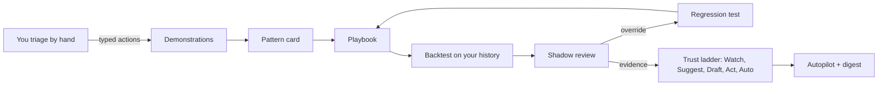

<p align="center">
  
</p>

<p align="center">
  <a href="https://apprentice-agent.onrender.com"></a>
  <a href="https://apprentice-agent.pages.dev"></a>
  <a href="docs/demo.mp4"></a>
</p>
<p align="center">
  
  
  
  
  
</p>

**Apprentice** is an [Agent-Native](https://www.agent-native.com) app for issue triage. You work as usual. It records your clicks as typed demonstrations, turns repeated patterns into editable **playbooks**, **backtests** them against your own history, turns every correction into a **regression test**, and earns autonomy one rung at a time on a **trust ladder**. No prompt writing and no screen scraping.

Built for the [Builder.io Agent-Native Hackathon](https://www.builder.io/hackathon) (Nov 2026).

<p align="center">
  
  <br /><sub>Real recording of the running app (no mock-ups). Full quality: <a href="docs/demo.mp4">docs/demo.mp4</a></sub>
</p>

## Try it in 60 seconds

| | |
|---|---|
| **Live app** | https://apprentice-agent.onrender.com (Render free tier: the first visit can take about a minute to wake up) |
| **Demo account** | `judge@apprentice-demo.dev` / `apprentice-demo-2026` (demo data already loaded). Or create your own account and press **Load demo data**. |
| **Website** | https://apprentice-agent.pages.dev |
| **Source** | this repo, MIT licensed |

Then: open **#31** and **#32**, label `bug` + `needs-info`, press `r` (request repro), assign `triage`. The pattern card appears. Press **Make playbook**, open **Backtest**, toggle a condition and watch the numbers change.

## The problem

Queue work (issue triage, support tickets, inbound requests) is repetitive but full of judgment: "no version number, so ask for one", "crash with a stack trace, so P1 and core". Today's agents make you describe that judgment in a prompt and hope. Nobody trusts the result, so the work stays manual.

## The insight

In Agent-Native, the UI and the agent call **the same typed actions** (`defineAction`). Every click a human makes is already a structured, validated operation. **Your normal work is already a machine-readable demonstration.** Apprentice learns from it, then proves what it learned before it is allowed to act.



## Features

| | What happens | Where |
|---|---|---|
| **Watch** | Each typed action you take is recorded as a step, with the issue's features and the screen state. | Queue · "Watching ● N today" |
| **Notice** | After two similar demonstrations, a pattern card proposes a playbook with an inferred trigger and, per parameter, *fixed* / *from the issue* / *agent decides*. | Pattern card |
| **Assist** | Before a playbook even exists, a ghost chip predicts your next step. `Tab` runs it through the same action. | Issue action bar |
| **Edit** | Visual recipe: trigger, steps, checkpoints. Every save is a version and regenerates a portable `SKILL.md`. | Playbook editor |
| **Prove** | Backtest against your history (30 considered · 18 matched · 15 agreed) with live toggles. Every correction becomes a regression test; promotions and edits that break a test are blocked. | Backtest · Tests |
| **Trust** | 0 Watch · 1 Suggest (shadow) · 2 Draft (asks first) · 3 Act (with undo) · 4 Auto. Promotion needs evidence and a human click; an override at Act demotes automatically. | Trust ladder · Review |
| **Explain** | "Who taught you this?" names the exact demonstrations and conditions behind every automated change. | "Why?" on any activity |
| **Undo** | One click reverts a whole run; later conflicting edits are protected. | Run history |
| **Scale** | Scheduled autopilot, in-app digest, MCP tools so Claude or ChatGPT can review a batch inline, skill export. | Insights · Settings |

| Live backtest | Your override became a failing test |
|---|---|
|  |  |
| **"Who taught you this?"** | **Insights dashboard** |
|  |  |

## For reviewers: rubric → evidence

Every claim below points to code you can open.

| Criterion | What to look at | Evidence |
|---|---|---|
| **Usefulness & execution** (40%) | A complete working loop that removes manual triage: watch → pattern → playbook → backtest → review → test → promote → act → undo. | Live app above · full-loop integration test [`server/apprentice/__tests__/flow.test.ts`](server/apprentice/__tests__/flow.test.ts) · 55 tests (`pnpm test`) |
| **Creativity & design** (20%) | Trust ladder, ghost chip, parameter-owner chips, provenance drawer, dashboard with promotion-gate lines, dark "Eclipse" theme with glass controls. | [`app/components/apprentice/`](app/components/apprentice/) · [`app/routes/insights.tsx`](app/routes/insights.tsx) · [`app/global.css`](app/global.css) |
| **Innovation** (20%) | Learns from what you do instead of what you write; corrections become regression tests; autonomy is earned with evidence, not granted. | Engine: [`triggers.ts`](server/apprentice/engine/triggers.ts), [`backtest.ts`](server/apprentice/engine/backtest.ts), [`tests.ts`](server/apprentice/engine/tests.ts), [`trust.ts`](server/apprentice/engine/trust.ts) |
| **Use of Agent-Native** (20%) | UI and agent share one set of actions; human calls become demonstrations; the trust ladder is the framework's `needsApproval` gate. | [`actions/`](actions/) (62 actions) · [`server/apprentice/action-helpers.ts`](server/apprentice/action-helpers.ts) · [`server/apprentice/services/approval.ts`](server/apprentice/services/approval.ts) · [`services/record-step.ts`](server/apprentice/services/record-step.ts) |

## How it uses Agent-Native

| Apprentice feature | Framework mechanism |
|---|---|
| Demonstrations | Domain `defineAction`s are the only write path. Calls from the UI (`caller: "frontend"`) are recorded as steps; `audit.target` = issue backs provenance. |
| Context capture | `readAppState("navigation" / "selection")` is snapshotted with every step; Lessons merge the framework **Recorder** report. |
| Agent awareness | `view-screen` hydrates the open issue, ghost suggestion, playbook, focused decision and pattern candidates. |
| Agent moves the UI | `focus-issue` writes the one-shot `navigate` command. |
| **Trust ladder** | A **`needsApproval` predicate** on every domain action: calls with `playbookContext` are gated by the playbook's level and checkpoint flags. At Draft the agent's call pauses for Approve/Deny. Ad-hoc calls are never gated. |
| Tests | Playbook regression tests in Postgres; agent-behavior gate in [`evals/apprentice.eval.ts`](evals/apprentice.eval.ts) (`defineEval`, `usesTool`, `llmJudge`). |
| Autopilot | `install-autopilot` writes a scheduled job into Agent Resources (`resourcePut`). |
| External agents | `mcpTool: true` on `list-playbooks`, `run-playbook`, `review-batch`, `get-insights`, `export-skill`; `review-batch` uses **`embedRoute`** so `/review` renders inline in MCP App hosts. |
| Live sync | `useDbSync({ realtime })` on Queue and Review, where the agent or autopilot changes data while you watch. |
| Agent instructions | [`AGENTS.md`](AGENTS.md) plus four skills in [`.agents/skills/`](.agents/skills/): `triage-domain`, `apprentice-teacher`, `playbook-runner`, `shadow-reviewer`. |

## Architecture and deployment

| Layer | Choice |
|---|---|
| App | Agent-Native 0.226 (React Router, Nitro), TypeScript strict |
| Data | Drizzle + Postgres ([Neon](https://neon.tech)) in production, PGlite locally |
| Hosting | [Render](https://render.com) web service (`NITRO_PRESET=render_com`) |
| Website | Vite + React + Framer Motion in [`landing/`](landing/), on Cloudflare Pages |
| Agent model | Any provider the framework supports. The hosted demo uses Groq (`openai/gpt-oss-120b`). |

## Run it locally

Requires Node 22.22+ and pnpm.

```bash
git clone https://github.com/LSUDOKO/Apprentice.git
cd Apprentice
corepack enable && pnpm install
pnpm dev                     # http://localhost:8080
```

> If your shell sets `NODE_OPTIONS=--no-experimental-strip-types`, run `env -u NODE_OPTIONS pnpm dev`.

Choose **Load demo data** (60 invented issues plus past demonstrations, including a second teacher for Team mode). For the agent (chat, Draft-level approvals, the tuner, evals), add a key to `.env`: `ANTHROPIC_API_KEY`, `OPENAI_API_KEY` or `GROQ_API_KEY`.

```bash
pnpm typecheck               # TypeScript strict
pnpm test                    # 55 engine + integration tests (in-memory PGlite)
pnpm agent-native:doctor     # framework guards
pnpm eval                    # agent behavior gate (needs an LLM key)
```

## Project layout

```
actions/                       one defineAction per operation (UI, agent, MCP and CLI all call these)
server/apprentice/engine/      pure TypeScript: features, signatures, trigger inference, bindings,
                               backtest, tests, trust ladder, drift, ghost prediction, SKILL.md
server/apprentice/services/    DB-backed services: mutation path, step recording, patterns,
                               playbooks, executor + undo, provenance, insights, seed
server/db/                     Drizzle schema + additive migrations
app/routes/                    issues, playbooks, review, exceptions, insights, lessons, compare, preferences
app/components/apprentice/     trust ladder, param chips, recipe editor, ghost chip, provenance, charts
.agents/skills/                agent skills;  AGENTS.md  agent instructions
evals/                         agent-behavior eval gate
landing/                       marketing website (Cloudflare Pages)
apprentice-build-kit/          the spec this was built from
```

## Built during the hackathon

See [BUILT-DURING-HACKATHON.md](BUILT-DURING-HACKATHON.md). The starting point is the unmodified Agent-Native `chat` template (its own commit). Everything under `actions/`, `server/apprentice`, `server/db`, the Apprentice routes and components, the seed data, the tests and `landing/` is new. Progress notes and verification: [PROGRESS.md](PROGRESS.md).

## Limitations

- Learning is per user. Team mode compares teachers inside one workspace, but playbooks are not shared through org sharing yet.
- Steps that commute (label vs. assign order) count as different signatures.
- Agent-decides parameters are not scored in backtests.
- The hosted agent runs on Groq's free tier, which allows 8,000 tokens per minute. One agent turn with Apprentice's tools needs about 20,000, so chat on the hosted demo needs a paid tier or another provider key. The whole UI loop works without the agent.
- GitHub import is read-only and unauthenticated (60 requests/hour). Apprentice never writes to GitHub.

## License

MIT
