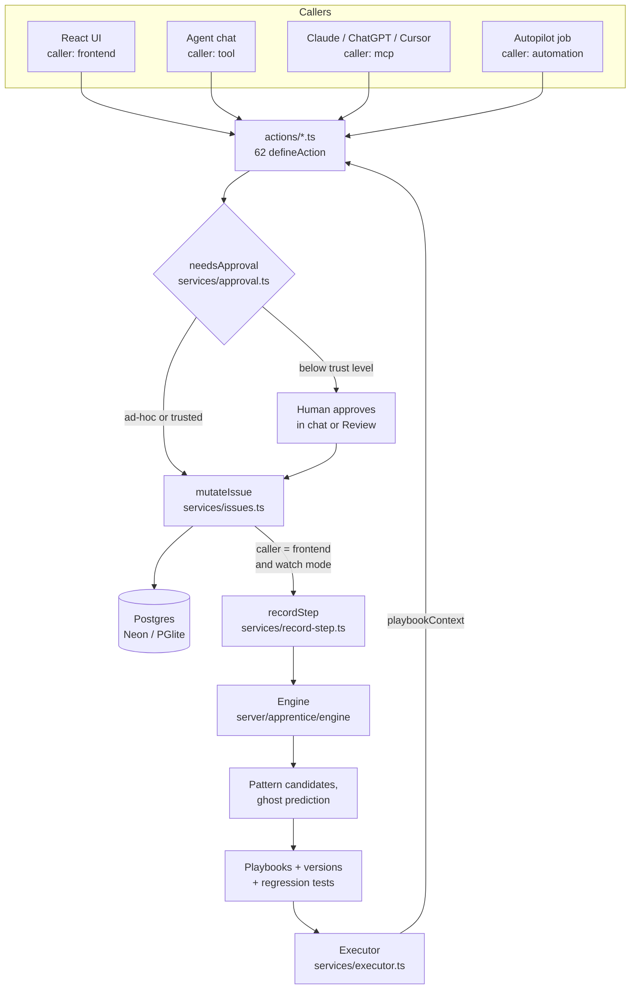
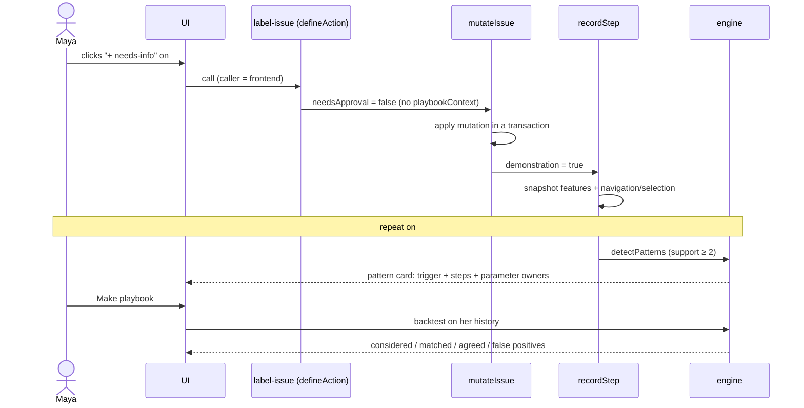
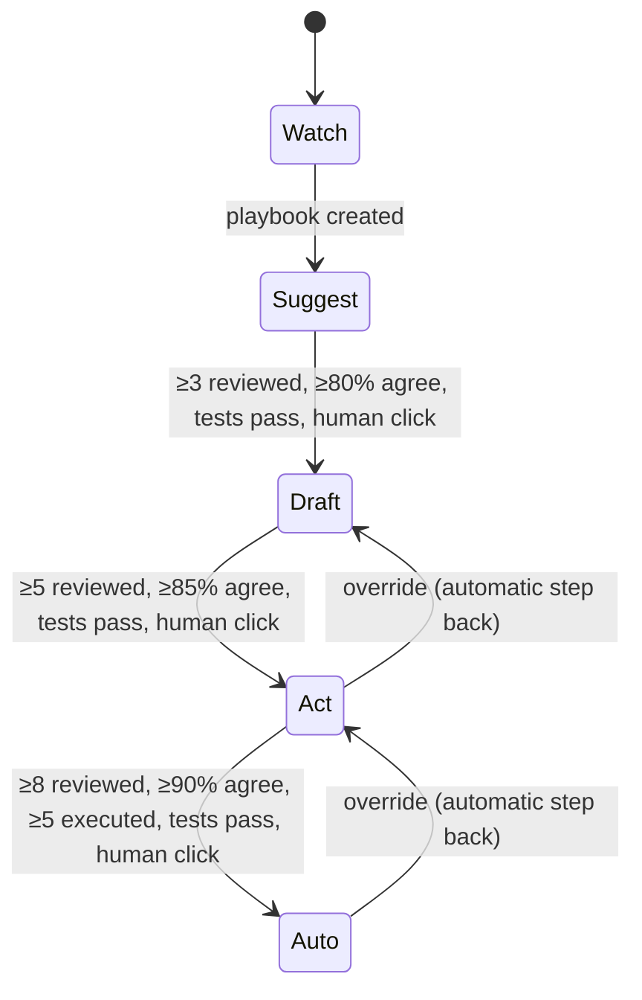
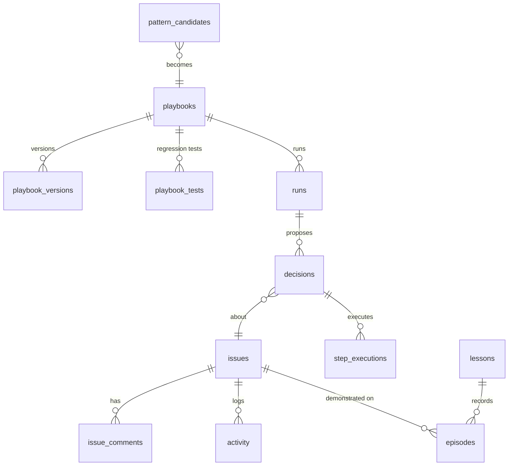

# Architecture

How Apprentice is put together, for humans and coding agents reading the repo. For the framework-specific proof points, see [AGENT-NATIVE-EVIDENCE.md](AGENT-NATIVE-EVIDENCE.md).

## System overview

Every caller goes through the same typed actions. Writes to issues go through one function, `mutateIssue`. That function decides whether the call is a demonstration (a human click), a playbook execution (gated by the trust ladder), or a plain ad-hoc change.

## The learning loop, step by step

## The trust ladder

Thresholds shown are demo mode (`engine/trust.ts`, `thresholdsFor`). What each level means for an action called with `playbookContext` (`services/approval.ts`, `stepNeedsApproval`):

| Level | Behaviour |
|---|---|
| 0 Watch | Recording only |
| 1 Suggest | Shadow: decisions are proposed, nothing changes until a human approves |
| 2 Draft | Every step asks for approval |
| 3 Act | Runs on its own; asks only at checkpoints or for destructive actions; every run can be undone |
| 4 Auto | Runs on its own |

## Data model

15 Apprentice tables in [`server/db/schema.ts`](../server/db/schema.ts), all scoped by `owner_email` / `org_id`. The main relationships:

Also: `suggestion_events` (ghost chip accept/ignore), `digests`, `apprentice_settings`.

## Engine (pure TypeScript, no I/O)

[`server/apprentice/engine/`](../server/apprentice/engine/) is deterministic and unit-tested.

| File | What it does |
|---|---|
| `features.ts` | Derives issue features: kind, has version, has repro, stack trace, code block, mentions docs or a component, likely spam, first-time author |
| `signature.ts` | Normalises a demonstration's steps into a comparable signature (with step merging) |
| `patterns.ts` | `detectPatterns`, `inferTrigger` (discriminative conditions from positives vs negatives), `findConflicts` (two teammates, two approaches) |
| `bindings.ts` | Infers who owns each parameter: fixed, from the issue, or agent decides |
| `triggers.ts` | Evaluates trigger conditions against an issue |
| `backtest.ts` | Replays a trigger and steps on past demonstrations: considered, matched, agreed, missed, false positives |
| `tests.ts` | Regression tests from review verdicts; an override with no steps means "should not apply" |
| `trust.ts` | Thresholds, rolling agreement, eligibility, drift (auto step back) |
| `predict.ts` | Next-step prediction for the ghost chip |
| `metrics.ts` | Time saved, estimated from the user's median handling time |
| `skill-markdown.ts` | Generates the portable `SKILL.md` |

## Services (database-backed)

[`server/apprentice/services/`](../server/apprentice/services/): `issues.ts` (single mutation path), `record-step.ts` (demonstrations), `patterns.ts`, `playbooks.ts` (versions, test gate, eligibility), `executor.ts` (runs, decisions, review, drift, undo with conflict protection, provenance), `approval.ts` (trust gate), `assist.ts` (ghost, exceptions), `ops.ts` (insights, digest, autopilot, GitHub import), `lessons.ts`, `seed.ts`, `settings.ts`.

## UI

[`app/routes/`](../app/routes/): queue and issue detail (`issues*.tsx`), playbook editor (`playbooks.$playbookId.tsx`: Recipe, Backtest, Tests, Provenance, History, SKILL.md), review (`review.tsx`), exceptions, insights (charts in `app/components/apprentice/Charts.tsx`, hand-written SVG), lessons, compare, settings (`preferences.tsx`). Components live in [`app/components/apprentice/`](../app/components/apprentice/).

## Tests

- 55 Vitest tests: engine units plus a full-loop integration test on in-memory PGlite ([`server/apprentice/__tests__/flow.test.ts`](../server/apprentice/__tests__/flow.test.ts)): seed → watch → pattern → ghost → playbook → backtest → shadow review → override test blocks promotion → fix → Draft → Act run → provenance → undo.
- Agent-behaviour eval gate: [`evals/apprentice.eval.ts`](../evals/apprentice.eval.ts) (needs an LLM key).

## Deployment

| Piece | Where |
|---|---|
| App | Render web service, `NITRO_PRESET=render_com`, start `node .output/server/index.mjs` |
| Database | Neon Postgres; app tables are created at startup by additive migrations ([`server/db/migrations.ts`](../server/db/migrations.ts)) |
| Website | `landing/` (Vite + React + Framer Motion) on Cloudflare Pages |
| Demo film | `video/` (Remotion); screenshots captured by a Playwright script against the running app |
